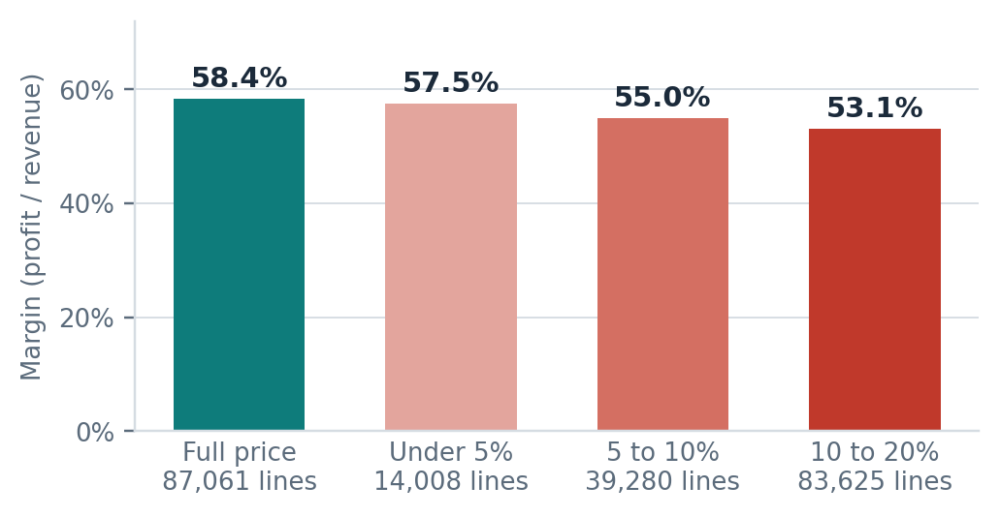
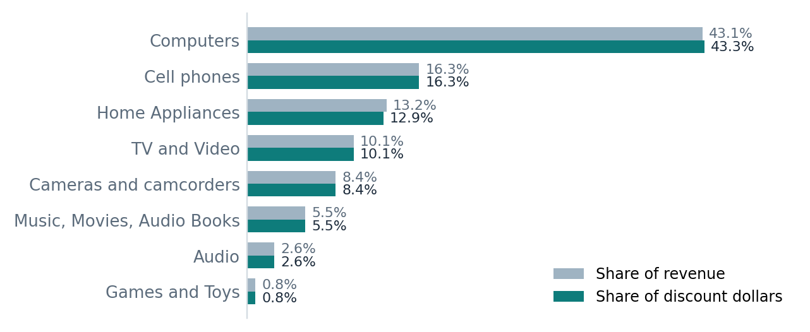
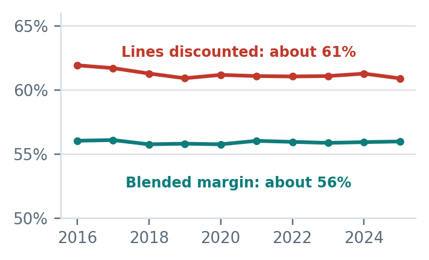
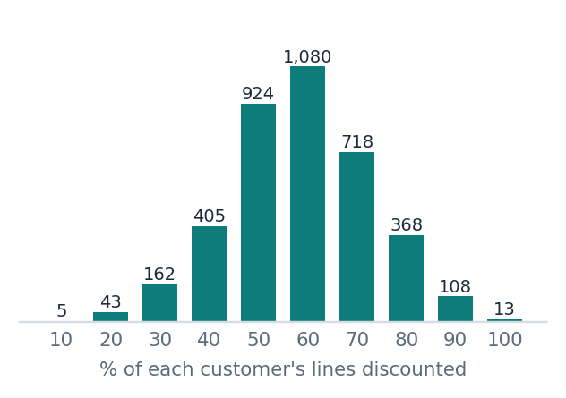

# Retail Discounting: Profitability Audit
**Full analysis:** `docs/final_summary.md` | **Founder-facing report (4 pages):** `docs/retail_discount_audit_report.pdf`

An end-to-end audit of what discounting costs a retailer, where the cost sits, and what a business would need to test before changing its pricing. Built on the Contoso Retail dataset (synthetic), with SQL, Python and Power BI.

---

## Problem Statement

Discounting is one of the most common levers in retail pricing, but its cost is rarely measured in dollars. This project asks:

- How much does discounting cost, in dollars and as a share of revenue and profit?
- Is it applied selectively, or as a standing practice across categories, locations, customers and years?
- Is the margin loss anything beyond the price cut itself?
- Can the data say whether the discounts pay for themselves, and if not, what would a test have to show?

---

## Executive Conclusion

Discounting here is a standing practice, not a targeted tool, and it costs $13.8M.

- 61% of order lines are sold below list price, at a steady rate in every year from 2016 to 2025
- The discounts total $13.8M: 6.3% of revenue and 11.3% of profit, about $101 per discounted line
- Every category and every sales location is discounted the same way, and none of category, store, customer or year explains which sales get a discount
- The margin loss is the price cut itself: discounted sales carry no hidden extra cost
- Whether the discounts pay for themselves depends on how many discounted sales would be lost without them. The break-even is 16.5% (about 1 in 6), and this dataset cannot show which side the business is on

## Technical Stack

| Layer | Tools |
|---|---|
| Database | PostgreSQL |
| Analysis | SQL, Python (Pandas, Matplotlib) |
| Visualization | Power BI |
| Storage | Parquet |
| Version Control | Git + GitHub |

## Project Scope

| Phase | Status |
|---|---|
| SQL analysis (baseline, discount cost, tiers, categories, customers, stores, trend) | Complete. Final figures use blended margin |
| Python analysis (validation, category analysis, customer segmentation) | Notebooks 1 to 2 use average line margins and the earlier customer segmentation. Superseded by the SQL figures; see `docs/decisions_log.md` |
| Dashboard (Power BI) | Being updated to the final figures |
| Final reporting | Complete: `docs/final_summary.md` and the 4-page report |

---

## Dataset Overview

**Source:** Contoso Retail (synthetic dataset)

**Grain:** Order line. Each row is a single product within a single order.

**Scale:** 223,974 order lines, 93,470 orders, 52,189 customers, 2016 to 2025

**Locations:** 64 sales locations that recorded sales: 63 stores plus the online channel (42% of order lines)

**Tables used:**

| Table | Role |
|---|---|
| `orderrows` | Primary transaction grain: prices, costs, quantities |
| `orders` | Order header: date, store, customer linkage |
| `customer` | Customer dimension |
| `product` | Product and category dimension |
| `store` | Store location and status |
| `date_dim` | Time dimension for trend analysis |
| `currency_exchange` | Present in schema; not needed. List prices are already in one common currency (checked) |

**Margin basis:** all margins are blended, `SUM(profit) / SUM(revenue)`.

---

## Business Questions Answered

1. What does discounting cost, in dollars?
2. Does margin fall with discount depth, and is that more than the price cut itself?
3. Which categories carry the most discount dollars, and are any discounted differently?
4. Do discount rates differ by customer, store or year?
5. How many discounted sales must the discount win for it to pay off?

## Analytical Approach

The SQL analysis follows a structured sequence. Each file addresses a distinct business question.

- Establish scale and financial baseline across all transactions
- Compare blended margin for discounted and full-price lines
- Measure total discount dollars and a break-even test
- Segment discounted lines by depth tier and compare observed margin with what a price cut alone predicts
- Compare categories on share of lines discounted, discount dollars and discount as a share of revenue
- Test whether customers differ in discount rate once enough lines per customer are observed
- Examine location-level discount rates against what chance would produce
- Validate discount rate and margin year over year

---

## Key Findings

- 136,913 of 223,974 order lines (61.1%) are sold below list price. No line is discounted by 20% or more.
- Blended margin is about 54% on discounted lines and 58.4% on full-price lines.
- Discounts total $13.8M: 6.3% of revenue and 11.3% of profit, about $101 per discounted line.
- Margin by depth tier is 57.5% (under 5%), 55.0% (5 to 10%) and 53.1% (10 to 20%). A price cut alone predicts 57.4%, 55.0% and 52.8%, so the margin loss is the price cut itself.
- The 10 to 20% tier holds 61% of discounted lines.
- Every category has 60.6% to 61.5% of lines discounted and gives up 6.2% to 6.4% of revenue. Computers and Cell phones hold 60% of discount dollars because they hold 59% of revenue.
- Discount rates run from 58.3% to 64.7% across the 64 locations. The spread is what chance alone would produce.
- The discount rate is between 60.9% and 61.9% in every year from 2016 to 2025, and blended margin between 55.8% and 56.1%.
- Among the 3,826 customers with 10 or more order lines, discount rates cluster around the average. 13 were discounted on every line and none on fewer than 10%.
- Removing discounts would pay off only if fewer than 16.5% of discounted sales were lost. The data has no demand information, so the test has to come from an experiment.

---

## Visualizations

Chart exports are in `exports/`.

**Margin by Discount Tier**

Margin falls from 58.4% at full price to 53.1% in the 10 to 20% tier, by the amount a price cut alone predicts.

**Category Share of Revenue vs Share of Discount Dollars**

Each category's share of discount dollars matches its share of revenue. Category totals follow category size.

**Discount Rate and Margin by Year**

Both stay flat from 2016 to 2025.

**Customers with 10 or More Order Lines, by Share of Lines Discounted**

Customers with enough lines to measure cluster around the 61% average. There is no group that is always, or never, discounted.

## Power BI Dashboard

The Power BI dashboard (`powerbi/`) is being updated to the final blended figures. The numbers in `docs/final_summary.md` and the report are the reference.

## Final Executive Report

A 4-page, founder-facing report on what the discounts cost, where they sit, and what to do next.

Contents:
- The answer on page 1: $13.8M given, 61% of lines discounted, and the 1-in-6 break-even
- Margin by discount tier and the break-even test
- Where the discounts sit: categories, years, customers and locations
- Three recommendations (a discount budget, a reason code on every discount, and a controlled test on the 10 to 20% tier), what not to do, and what the data cannot tell you
- Method notes

Location: `docs/retail_discount_audit_report.pdf`

## Repository Structure

```
retail-discount-profitability-audit/
│
├── data/
│   ├── raw/          # Source CSV files (excluded via .gitignore)
│   └── processed/    # Cleaned or transformed outputs (pending)
│
├── docs/
│   ├── decisions_log.md                  # Analytical decisions and justifications
│   ├── final_summary.md                  # Full written audit
│   └── retail_discount_audit_report.pdf  # 4-page founder-facing report
│
├── exports/          # Chart exports used in this README
│
├── powerbi/          # Pricing audit dashboard (.pbix + assets), being updated
├── python/           # Validation, category analysis, customer segmentation notebooks (superseded by SQL figures)
│
├── sql/
│   ├── 00_schema.sql                    # Table definitions
│   ├── 01_load.sql                      # Data loading
│   ├── 02_exploration.sql               # Scale and financial baseline
│   ├── 03_discount_impact.sql           # Discounted vs. full-price performance
│   ├── 04_profit_leakage.sql            # Margin by discount tier
│   ├── 05_discount_drivers.sql          # Category-level discount volume and impact
│   ├── 06_customer_discount_behavior.sql # Customer discount rates (segmentation not used as evidence)
│   ├── 07_discount_trend_over_time.sql  # Year-over-year trend analysis
│   ├── 08_store_discount_behavior.sql   # Store-level discount and margin comparison
│   └── 09_discount_cost_and_checks.sql  # Discount dollars, break-even test, currency check
│
├── .gitignore
└── README.md
```

---

## What This Project Demonstrates

- Business-oriented SQL analysis built around one question: what does discounting cost?
- Measuring a cost in dollars and testing it against a break-even instead of reporting margin points alone
- Checking a finding before reporting it: an early customer segmentation was set aside after a direct test showed it came from small line counts
- Translation of findings into a short founder-facing report
- Structured analytical documentation, including a decisions log with superseded decisions recorded

## How to Reproduce

**Requirements:** PostgreSQL (tested on v18.3)

1. Create a database and run `00_schema.sql` to set up all tables
2. Place raw CSV files in `data/raw/` and update file paths in `01_load.sql` to match your local directory
3. Run `01_load.sql` to load all source data
4. Run SQL files `02` through `09` in order. Each file is self-contained and includes its business question, queries, recorded results and insight.

No external dependencies are required for the SQL phase.

---

## Limitations

- **Synthetic data.** The Contoso dataset does not represent a real business. Patterns reflect how the data was generated and should not be read as real-world conclusions.
- **No demand data.** The dataset cannot show whether discounting wins extra sales or only lowers the price on sales that would have happened anyway. The break-even test shows what a controlled test would have to show.
- **No discount drivers.** There is no promotion, campaign or reason field. Product, quantity and promotion calendar were not tested as drivers.
- **Line-level margin only.** Margin is profit over revenue per order line. Overhead, returns, shipping and marketing cost are excluded.
- **Discount tiers are analytically defined.** Tier boundaries (5%, 10%, 20%) are set for pattern detection, not derived from internal pricing policy.
- **Closed stores are included.** Store lifecycle fields were not used to filter transactions.

---

## Next Steps

- Update the Power BI dashboard to the final blended figures
- Re-run the Python notebooks on the blended margin basis
